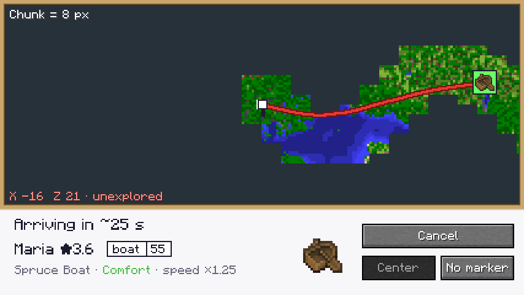
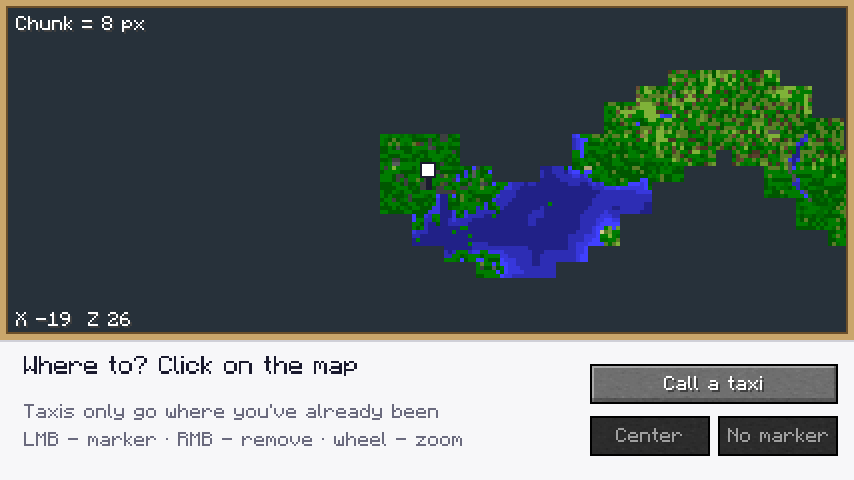
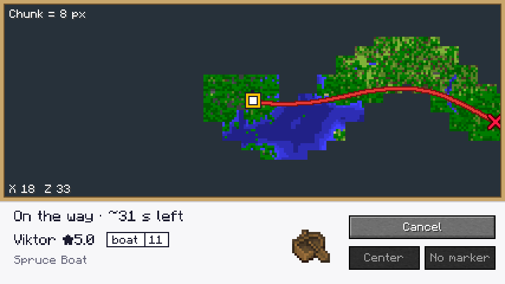

# OKAK Taxi 🚕

A Fabric mod for **Minecraft 26.1.2** that adds a taxi service to your map.

Open the taxi map, put a marker on it, call a taxi, and a driver brings a vehicle to you. The map shows how long until it arrives and the route it takes. Get in and the driver takes you to the marker. **You can only travel to places you have already been**: unexplored areas are dark on the map, and the route only goes through explored chunks.



## How to play

| Action | How |
|---|---|
| Open the taxi map | **Y** (change it in Controls → Taxi) |
| Put a marker | Left-click on an explored part of the map |
| Remove the marker | Right-click on the map, or the **No marker** button |
| Zoom / pan | Mouse wheel / drag with the left button |
| Call a taxi | **Call a taxi** button |
| Get in | Walk up to the glowing boat, or right-click it (or the grass next to it) |
| Get out early | Shift, the usual way (this ends the trip) |

1. Explore the world. Everything within about 2 chunks of you is saved to the map.
2. Press **Y**. The map shows only the places you have been, in vanilla map colours.
3. Click where you want to go. A red route and the trip time appear.
4. Press **Call a taxi**. You see "Arriving in ~30 s", the driver's name and rating, the plate (`boat 36`) and the taxi icon moving along the route.
5. When the taxi arrives, it **glows** in its class colour, with a bell sound and a burst of particles. Walk up to it (or right-click) and the trip starts on its own. A **friend** can take the second seat.
6. At the marker the driver drops you off and the taxi disappears.

You can move the marker during the trip, and the driver rebuilds the route.

| Explored map | Riding to the marker |
|---|---|
|  |  |

## Features

- **Exploration memory**: every player keeps their own list of visited chunks per dimension. It survives restarts and death.
- **Route only through explored places**: A* over the grid of explored chunks, then smoothed into a curve. If explored areas are not connected, you get "No route".
- **Different vehicles**: a random boat of any wood type (oak, spruce, birch, jungle, acacia, cherry, dark oak, pale oak, mangrove) or a bamboo raft.
- **Taxi classes by stars**: the driver's rating decides the glow colour, trail particles and speed:
  | Stars | Class | Colour | Speed |
  |---|---|---|---|
  | ★1 | Turtle | red | ×0.6 |
  | ★2 | Economy | orange | ×0.8 |
  | ★3 | Standard | blue | ×1.0 |
  | ★4 | Comfort | green | ×1.25 |
  | ★5 | Premium | gold | ×1.5 |
- **Ride with a friend**: the boat has two seats. A friend can get in while the taxi waits, and both of you are dropped off at the marker.
- **Drivers** with names and ratings, plates like `boat 36`, and a name tag above the vehicle.
- The taxi glides over land and water, keeps its height over gaps, and drives through tree leaves.
- **HUD card** in the top-right corner while you wait or ride.
- Languages: Ukrainian, Russian, English, Polish, German, Spanish.
- Multiplayer: each player has their own taxi and map; only the owner picks the destination.

Taxis don't work in the Nether (the bedrock roof blocks navigation). The Overworld and the End are supported.

## Building

You need **JDK 25**.

```bash
./gradlew build
```

The jar ends up in `build/libs/taxi-1.1.0.jar`. Put it in `mods/` along with [Fabric API](https://modrinth.com/mod/fabric-api) (0.155.3+26.1.2 or newer) and Fabric Loader 0.20.1+. The mod must be installed on **both the client and the server**.

### Tests

There is a full client game test that creates a world, explores a strip of land, sets a marker, calls a taxi, boards it and rides to the end. Screenshots of each step go to `build/run/clientGameTest/screenshots/`:

```bash
./gradlew runClientGameTest          # needs a display; on a server use: xvfb-run ./gradlew runClientGameTest
```

## Project layout

```
src/main/java/com/okak/taxi/
  TaxiMod.java              – initialisation, events
  entity/                   – TaxiEntity (a boat with no physics) and its variants
  explore/                  – exploration memory (ExploredData, ExplorationTracker, ChunkSampler)
  route/                    – route building (A*, smoothing)
  service/TaxiService.java  – orders: approach → waiting → riding → arrival
  net/                      – network packets
src/client/java/com/okak/taxi/client/
  TaxiMapScreen.java        – the taxi screen (map + bottom panel)
  ClientMapData.java        – client-side map cache and textures
  TaxiHud.java              – HUD card
src/gametest/               – end-to-end client test
```
